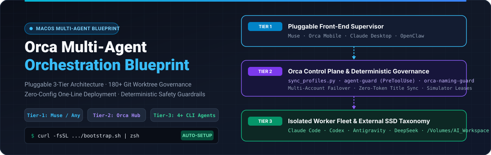
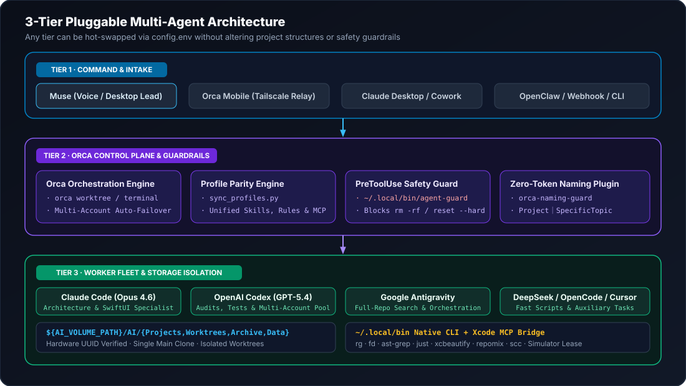
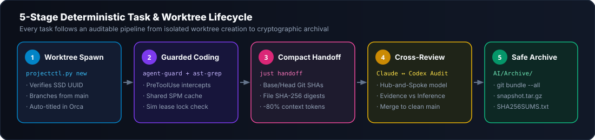
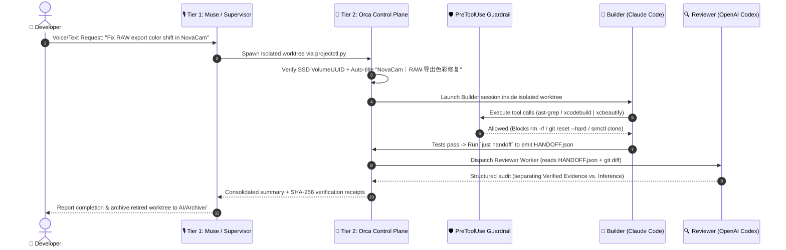

<div align="center">



<br/>

[](./README.en.md)
[](./README.zh-CN.md)
[](./AGENT_INSTALL.md)
[](https://github.com/Rem021/orca-multi-agent-blueprint)
[](./LICENSE)

**Production-Grade macOS 3-Tier Pluggable Multi-Agent Architecture · 180+ Git Worktree Governance · One-Line Zero-Config Deployment**

[⚡ 30-Second Quick Start](#-1-30-second-quick-start-new--existing-macs) · [🏛️ 3-Tier Pluggable Stack](#️-2-3-tier-pluggable-architecture) · [📂 Directory Taxonomy](#-4-external-ssd-directory-taxonomy--4-folder-standard) · [🛡️ Guardrails & Skills](#️-6-skill-matrix--pretooluse-safety-guardrails) · [📈 Quantified Benefits](#-8-bottlenecks-solved--quantified-engineering-gains)

</div>

---

## ⚡ 1. 30-Second Quick Start (New & Existing Macs)

Whether you are setting up a **brand-new Mac** or optimizing an **existing Mac with dozens of repositories, 180+ Git worktrees, and multiple AI coding agents**, you can deploy the entire stack non-destructively in one step:

> [!TIP]
> **Option A: Paste This Repo Link Directly to Any AI Agent (Zero Manual Work)**
> Copy and send this prompt to **Claude Code, OpenAI Codex, Google Antigravity, Cursor, or Muse**:
> ```text
> Please read https://github.com/Rem021/orca-multi-agent-blueprint/blob/main/AGENT_INSTALL.md and follow its protocol to automatically deploy and optimize my Mac multi-agent workflow (run --dry-run first, then execute --auto and show me the doctor.py report).
> ```

### Option B: One-Line Terminal Bootstrap (`bootstrap.sh`)

Open your macOS terminal (`Terminal` / `Ghostty` / `iTerm2`) and run:

```bash
curl -fsSL https://raw.githubusercontent.com/Rem021/orca-multi-agent-blueprint/main/bootstrap.sh | zsh
```

<details>
<summary>🔍 <b>Want to preview changes first (`--dry-run`) or see the 6 automated steps under the hood? (Click to expand)</b></summary>

<br/>

**Read-Only Preview Mode (`--dry-run`, zero file mutations):**
```bash
curl -fsSL https://raw.githubusercontent.com/Rem021/orca-multi-agent-blueprint/main/bootstrap.sh | zsh -s -- --dry-run
```

**What the Auto-Discovery Engine (`bootstrap.sh` + `scripts/discover_and_adopt.py`) Does Automatically:**
1. **Storage & Volume UUID Detection**: Automatically detects any dedicated external SSD under `/Volumes/*` (extracting its hardware `VolumeUUID` via `diskutil` to prevent unmounted mountpoint writes), or falls back cleanly to `~/AI-Workspace`.
2. **Non-Destructive Project Adoption**: Scans all existing repositories in `AI/Projects/*` and Orca (`orca repo list`), creating missing `docs/`, `reports/`, `outputs/`, and `work/` directories without touching your source code, and adding `/work/` to `.git/info/exclude`.
3. **Simulator & Agent Fleet Discovery**: Detects available iOS Simulators (`xcrun simctl`) for lease coordination and identifies installed CLI agents (`claude`, `codex`, `antigravity`, `dsh`, `opencode`, `cursor`) to generate `config.env`.
4. **Zero-Dependency Native CLI Toolchain**: Installs native `arm64`/`x86_64` binaries (`rg`, `fd`, `ast-grep`, `just`, `xcbeautify`, `scc`, `repomix`) into `~/.local/bin` without requiring Homebrew or `gh` auth, and configures `~/.zshenv` for non-interactive agent subshells.
5. **Multi-Account / Multi-Profile Parity**: Synchronizes global rules (`AGENTS.md`, `CLAUDE.md`, `GEMINI.md`), `PreToolUse` safety hooks, Xcode MCP bridges, and skill symlinks across **every** Orca Claude Profile, Codex Account, and Antigravity session.
6. **Automated Self-Test & Health Audit**: Runs `test_guard.py`, `orca-naming-guard` unit tests, and `doctor.py` (Schema v2).

</details>

---

## 🏛️ 2. 3-Tier Pluggable Architecture

Running multiple coding agents concurrently on macOS quickly hits four walls: **context window pollution**, **single-account rate limits**, **working tree collisions**, and **missing PATH/MCP configs in non-interactive shells**. This blueprint decouples your stack into **three hot-swappable tiers**:

<div align="center">
  
</div>

### 2.1 Responsibilities & Hot-Swapping Matrix

| Tier | Architectural Role | Default Component | Pluggable Alternatives (`config.env`) | Core Responsibility |
| :--- | :--- | :--- | :--- | :--- |
| **Tier 1** | **Front-End Supervisor**<br/>*(Command & Intake)* | **Muse**<br/>*(Voice / Desktop Lead)* | · **Orca Mobile** *(Tailscale Remote)*<br/>· **Claude Desktop / Cowork**<br/>· **OpenClaw / Custom Webhook** | Receives high-level user intent, decomposes cross-repo tasks, dispatches worktrees, and summarizes verification receipts |
| **Tier 2** | **Control Plane & Hub**<br/>*(Orchestrator)* | **Orca Desktop + CLI**<br/>*(macOS Local Hub)* | · **`just` + `projectctl.py`** *(Pure CLI)*<br/>· **GNU Parallel / Custom Runner** | Manages 180+ Git worktrees, handles multi-account quota failover, runs zero-token naming guard & `PreToolUse` safety hooks |
| **Tier 3** | **Worker Agent Fleet**<br/>*(Execution Sandboxes)* | **Claude Code + Codex + Antigravity + DeepSeek** | · **OpenCode / Cursor / Windsurf**<br/>· **Aider / Local LLMs** | Executes parallel coding, AST refactoring, simulator testing, and adversarial cross-reviews inside isolated Git worktrees |

> [!IMPORTANT]
> **How to Swap Any Supervisor or Worker Agent:**
> Edit `SUPERVISOR_AGENT` and `WORKER_AGENTS` in [`config.env`](./config.example.env) and run `./deploy.sh --sync-profiles`. All rules, skills, and safety guardrails re-align in under 2 seconds.

---

## 🔄 3. 5-Stage Deterministic Workflow & Cross-Agent Review

Every engineering task follows a strict 5-stage lifecycle from isolated worktree creation to cryptographic archival:

<div align="center">
  
</div>

### Hub-and-Spoke Adversarial Review (Claude Codes ↔ Codex Audits)

To eliminate single-model blind spots, the primary builder generates a compact `HANDOFF.json` receipt (`just handoff`, cutting handoff token overhead by **80%**) containing exact Git Base/Head SHAs and file SHA-256 digests, which a heterogeneous reviewer audits in a read-only pass:



---

## 📂 4. External SSD Directory Taxonomy & 4-Folder Standard

To prevent agents from polluting your internal macOS system drive, triggering iCloud sync storms (`~/Documents`), or committing scratch files into Git history, all workspaces follow a hardware-verified taxonomy (illustrated below with fictional project names):

```text
/Volumes/AI_Workspace/               # Dedicated external SSD (VolumeUUID verified before every write)
└── AI/
    ├── Projects/                    # [Single Main Entrypoint Layer] Exactly 1 canonical clone per repo (parked on main, clean)
    │   ├── Mac/                     # System maintenance & multi-agent governance repository
    │   ├── NovaCam/                 # Fictional Example A: Pro iOS Camera & RAW Engine
    │   ├── FlowWeave/               # Fictional Example B: Cross-Platform Rule & Workflow Engine
    │   ├── StarFront/               # Fictional Example C: Real-Time Strategy Game
    │   └── <AnyProject>/            # Standardized 4-Folder Internal Structure per project:
    │       ├── docs/                #   1. Long-term architecture specs & runbooks (Tracked in Git)
    │       ├── reports/             #   2. Stage audit reports & JSON receipts by YYYY-MM-DD-topic (Tracked in Git)
    │       ├── outputs/             #   3. Reusable tools, plugins & release deliverables (Tracked in Git)
    │       └── work/                #   4. Scratchpad, logs & 3rd-party references (Ignored via .git/info/exclude)
    │
    ├── Orca/Worktrees/              # [Orca Isolated Worktree Pool] 1 directory per parallel task
    ├── Codex/Worktrees/             # [Codex Isolated Worktree Pool] e.g., NovaCam-raw-color-fix
    ├── Claude/Worktrees/            # [Claude Isolated Worktree Pool]
    │
    ├── Archive/                     # [Reversible Cold Archive] Retired worktrees bundled here before removal
    │   └── 2026-11-06-raw-fix/      #   Contains repo.bundle + worktree-snapshot.tar.gz + SHA256SUMS.txt
    │
    └── Data/                        # [Shared Build Caches & Hardware Leases]
        ├── BuildCache/              #   Shared Xcode SourcePackages (SPM) cache (DerivedData stays isolated per worktree)
        └── SimulatorCoordination/   #   iOS Simulator lease locks (active-*/lease.json) to prevent test collisions
```

---

## 🏷️ 5. Zero-Token Workspace, Chat & Branch Naming Convention

When managing **180+ workspaces**, default random fish names (`lancetfish`, `soldierfish`) make navigation impossible. We enforce a deterministic naming convention powered by the local [`plugins/orca-naming-guard`](./plugins/orca-naming-guard) plugin:

| Object Type | Naming Pattern | Canonical Example (Fictional Projects) |
| :--- | :--- | :--- |
| **Main Repository Entry** | `Canonical Product Name` | `NovaCam`, `流织`, `星际前线`, `ChromaStudio`, `Mac` |
| **Dedicated Sub-Entry** | `ProjectName｜Purpose` | `NovaCam｜色彩引擎开发` |
| **Active Worktree & Chat** | `ProjectName｜SpecificTopic` | `Mac｜Orca 多智能体设置与命名整理`, `ChromaStudio｜色轮并发渲染修复` |
| **Idle Standby Workspace** | `ProjectName｜待命工作区 <8-char-hash>` | `NovaCam｜待命工作区 888c8500` |
| **Imported Reference Dir** | `ProjectName｜导入资料` | `NovaCam｜导入资料 A` |
| **Git Task Branch** | `<prefix>/<2-4-word-kebab-case>` | `codex/cloud-rule-save`, `claude/hdr-highlight-fix` |

**Typography Rules**:
1. Use a single **full-width pipe `｜`** (`U+FF5C`) with **no spaces** immediately around it.
2. Insert **one half-width space** between Chinese characters and ASCII technical terms (e.g., `NovaCam｜Metal4 渲染管线接管`).
3. Keep titles under 40 characters; omit dates, emojis, conversational prefixes ("Please help me..."), and unverified "Completed" claims.

---

## 🛡️ 6. Skill Matrix & `PreToolUse` Safety Guardrails

### 6.1 Unified Skill Matrix (Synced Across All Agent Profiles)

| Category | Skill Name | Engineering Purpose |
| :--- | :--- | :--- |
| **Orca Control** | `orchestration` | Spawn heterogeneous worker agents (e.g., dispatch Codex from Claude) and collect results |
| **Orca Control** | `orca-cli` | Programmatically drive Orca worktrees, managed terminals, repo settings, and browser |
| **Orca Control** | `orca-emulator` | Drive booted iOS Simulators inside Orca's emulator pane (taps, gestures, accessibility tree) |
| **Orca Control** | `orca-computer-use` | GUI automation for visible macOS app windows via accessibility tree when CLI is unavailable |
| **Code Intelligence** | [`ast-grep`](./skills/ast-grep/SKILL.md) | Syntax-aware AST search & rewrite across Swift/C/C++/Rust/TS/Python + `rg`, `fd`, `repomix`, `xcbeautify` |
| **Storage Hygiene** | `agent-slim` / `mole` | Audit AI session bloat, SQLite freelist pages, and deduplicate identical files via APFS `cp -c` |
| **Apple Specialists** | `swiftui-specialist` / `xctrace` | Authoritative SwiftUI / App Intents guidelines and `xctrace` command-line profiling |

### 6.2 Deterministic `PreToolUse` Safety Guardrail ([`scripts/guard.py`](./scripts/guard.py))

Markdown instructions only advise LLMs; `~/.local/bin/agent-guard` intercepts every Bash/Terminal tool call **before execution** (returning exit code `2` and structured JSON denial on violations):

| Rule ID | Blocked Command Pattern | Enforced Safe Alternative |
| :--- | :--- | :--- |
| **Rule 01** | Accessing `/Volumes/<Drive>/AI` when unmounted | Aborts immediately so agents never create fake directories on an unmounted stub |
| **Rule 02** | `rm -rf` on `AI/Projects`, `Worktrees`, or `Archive` | Archive via `just archive-worktree`, move to Trash, then run `git worktree remove` |
| **Rule 03** | `git reset --hard` or `git clean -f / -fdx` | Bundle uncommitted work to `AI/Archive/` via `git bundle` + `.tar.gz` first |
| **Rule 04** | `git worktree prune` without `--dry-run` | Always run `git worktree prune --dry-run` first to verify external drive state |
| **Rule 05** | `xcrun simctl create` or `xcrun simctl clone` | Reuse designated primary/secondary simulators and check `SimulatorCoordination` leases |
| **Rule 06** | Emptying Trash (`rm -rf ~/.Trash/*` / `EmptyTrash`) | Preserve Trash contents for emergency recovery |
| **Rule 07** | Pushing restricted branches (`develop`, `feat/C-*`) | Blocked at both `PreToolUse` and Git `pre-push` hook layers |

---

## 🛠️ 7. Standard Daily Operations (`Justfile`)

```bash
just --list                                  # List all standardized operational recipes
just verify-volume                           # 1. Verify external workspace volume mount & hardware UUID
just doctor                                  # 2. Run Schema v2 read-only health & profile parity audit
just slim-status                             # 3. Inspect physical vs. logical storage & SQLite freelist pages
just sim-leases                              # 4. Inspect active iOS Simulator leases & running xcodebuild jobs
just test-guardrails                         # 5. Run unit & integration tests for PreToolUse guardrails
just handoff repo="." goal="Stage complete"  # 6. Generate token-compact cross-agent HANDOFF.json receipt
just archive-worktree <path> <topic>         # 7. Safely bundle & checksum a worktree into AI/Archive/
```

---

## 📈 8. Bottlenecks Solved & Quantified Engineering Gains

| Dimension | Before (Ad-Hoc Multi-Agent Setup) | After (Orca Multi-Agent Blueprint) | Measured Engineering Gain |
| :--- | :--- | :--- | :--- |
| **Multi-Account Failover** | Switching profiles after rate-limiting loses skills, rules, and Xcode MCP | `sync_profiles.py` keeps all Claude/Codex/Antigravity profiles 100% identical | **Zero capability drop on account failover** |
| **Non-Interactive Shell PATH** | Subshells miss `rg`/`fd`/`ast-grep` and fall back to slow `grep -R` across `work/` | `~/.zshenv` injects native `~/.local/bin` tools + `.git/info/exclude` skips `/work/` | **5–10x faster code search & zero scratch pollution** |
| **Xcode Build & Test Logs** | Raw 50,000-line `xcodebuild` output floods context windows | Piped through `xcbeautify` + single-destination flags + simulator lease locks | **~90% fewer build log tokens & zero simulator deadlocks** |
| **Destructive Command Safety** | Prompt-only rules occasionally fail to stop `git reset --hard` or `rm -rf` | `PreToolUse` hook (`agent-guard`) blocks dangerous commands pre-execution | **100% deterministic interception of destructive commands** |
| **180+ Worktree Naming** | Unreadable fish names (`soldierfish`) or manual/LLM-billed renaming | `orca-naming-guard` local state machine assigns standby IDs & syncs valid titles | **Zero LLM tokens used; auto-organized within 3 seconds** |
| **Cross-Agent Handoffs** | Dumping chat transcripts leaves reviewers guessing what changed | `just handoff` emits exact Git SHAs, file SHA-256 digests & receipt paths | **80% smaller handoff context & 100% verifiable evidence** |

## 📄 License

Released under the [MIT License](./LICENSE).
