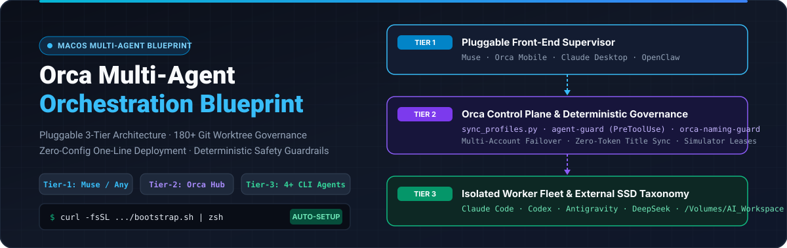
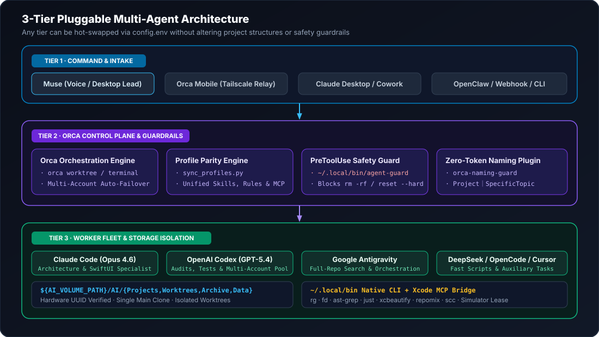
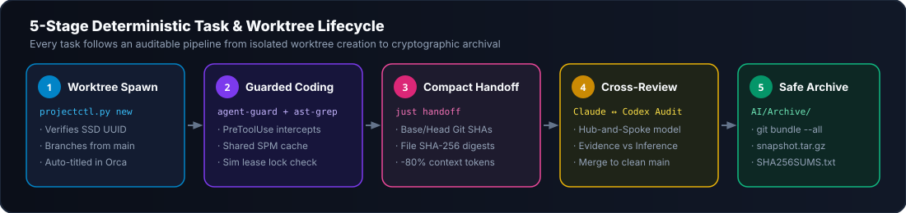

<div align="center">



<br/>

[](./README.zh-CN.md)
[](./README.en.md)
[](./AGENT_INSTALL.md)
[](./LICENSE)

**面向重度多智能体开发者的 macOS 三层可插拔架构 · 180+ Git 工作树治理 · 零配置一键部署蓝图**  
*Production-Grade macOS 3-Tier Pluggable Multi-Agent Architecture · 180+ Git Worktree Governance · One-Line Auto-Setup*

</div>

---

## ⚡ 30 秒全自动部署 / 30-Second Zero-Config Deployment

无论你是一台**刚拆封的全新 Mac**，还是一台**已有几十个存量项目、上百个工作树与多个 AI Agent 的主力开发机**，复制下方链接或命令即可全自动无损部署：

> [!TIP]
> **🤖 方式 A：直接把本仓库链接发给你的任意 AI Agent（零手动操作 / Paste to Any AI Agent）**  
> 复制下面这句话发送给 **Claude Code / OpenAI Codex / Google Antigravity / Cursor / Muse**：
> ```text
> 请阅读 https://github.com/Rem021/orca-multi-agent-blueprint/blob/main/AGENT_INSTALL.md 并按步骤为我自动部署和优化本机多 Agent 工作流（先运行 --dry-run 预览，再执行 --auto 部署并输出 doctor.py 报告）。
> ```

### 💻 方式 B：终端一行命令全自动部署 / One-Line Terminal Bootstrap

```bash
# 全自动探测外置盘/模拟器/存量项目与已安装 Agent，并一键完成对齐部署：
curl -fsSL https://raw.githubusercontent.com/Rem021/orca-multi-agent-blueprint/main/bootstrap.sh | zsh

# 或者先以只读模式预览（不修改任何文件）：
curl -fsSL https://raw.githubusercontent.com/Rem021/orca-multi-agent-blueprint/main/bootstrap.sh | zsh -s -- --dry-run
```

---

## 🏛️ 三层可插拔架构全景 / 3-Tier Pluggable Architecture

<div align="center">
  
</div>

<br/>

<div align="center">
  
</div>

---

## 📖 选择语言阅读完整架构与部署文档 / Full Documentation

| 语言 / Language | 完整文档入口 / Full Guide | 核心内容涵盖 / What's Inside |
| :--- | :--- | :--- |
| 🇨🇳 **简体中文** | [**👉 阅读中文完整版 (`README.zh-CN.md`)**](./README.zh-CN.md) | 三层可插拔架构（Muse + Orca + 多执行 Agent）、外置盘“四分法”目录规范、工作区与分支命名铁律、`PreToolUse` 安全硬护栏、全套技能矩阵与量化收益对比 |
| 🌐 **English** | [**👉 Read Full English Guide (`README.en.md`)**](./README.en.md) | 3-Tier Pluggable Stack (Muse + Orca + Worker Fleet), External SSD 4-Folder Taxonomy, Zero-Token Naming Guard, `PreToolUse` Safety Guardrails & Quantified Engineering Gains |
| 🤖 **AI Agents** | [**👉 Autonomous Agent Protocol (`AGENT_INSTALL.md`)**](./AGENT_INSTALL.md) | Step-by-step autonomous execution instructions for Claude Code, Codex, Antigravity, Cursor, and Muse |

---

<div align="center">

*以下为简体中文完整版正文（English readers please see [`README.en.md`](./README.en.md)）：*

</div>

---

## 🏛️ 一、三层职责与无缝热插拔机制

| 层级 | 架构角色 | 默认配置 | 可无缝替换的备选方案 (`config.env`) | 核心职责 |
| :--- | :--- | :--- | :--- | :--- |
| **Tier 1** | **前端总指挥官**<br/>*(Supervisor)* | **Muse**<br/>*(语音/桌面意图中心)* | · **Orca Mobile** *(手机远程语音)*<br/>· **Claude Desktop / Cowork**<br/>· **OpenClaw / 自定义 Webhook** | 接收自然语言需求、拆解跨项目任务、向中枢下发工作树指令、汇总审计简报 |
| **Tier 2** | **调度中枢与控制面**<br/>*(Control Plane)* | **Orca Desktop + CLI**<br/>*(macOS 本地调度器)* | · **`just` + `projectctl.py`** *(纯 CLI)*<br/>· **GNU Parallel / 编排脚本** | 管理 180+ Git 工作树生命周期、多账号配额自动故障转移、运行零 Token 命名插件与 `PreToolUse` 硬护栏 |
| **Tier 3** | **执行特工矩阵**<br/>*(Worker Fleet)* | **Claude Code + Codex + Antigravity + DeepSeek** | · **OpenCode / Cursor / Windsurf**<br/>· **Aider / 任意本地开源模型** | 在各自独立的 Git Worktree 沙箱中并行编码、AST 重构、运行模拟器测试并互审代码 |

---

## 📂 二、外置专盘目录标准与“四分法”体系

使用虚拟示例卷 `/Volumes/AI_Workspace` 与虚拟项目名（`NovaCam`、`FlowWeave`、`StarFront`、`ChromaStudio`）展示标准目录结构：

```text
/Volumes/AI_Workspace/               # 专用外置高速 SSD（每次写入前强制校验硬件 VolumeUUID）
└── AI/
    ├── Projects/                    # 【唯一主入口层】每个项目仅保留一个主克隆，长期停靠 main 且保持 clean
    │   ├── Mac/                     # 系统维护、多 Agent 编排工具与全局治理主仓
    │   ├── NovaCam/                 # 示例项目 A：专业相机应用主克隆
    │   ├── FlowWeave/               # 示例项目 B：跨平台规则与工作流引擎主克隆
    │   ├── StarFront/               # 示例项目 C：实时策略游戏主克隆
    │   └── <任意项目>/               # 统一实行项目内“四分法”标准结构：
    │       ├── docs/                #   1. 长期文档：架构规范、设计说明、运行手册（入 Git）
    │       ├── reports/             #   2. 审计回执：按 YYYY-MM-DD-topic 存放阶段报告与 JSON 证据（入 Git）
    │       ├── outputs/             #   3. 正式产物：可复用插件、工具脚本、交付包（入 Git）
    │       └── work/                #   4. 临时试验场：日志、草稿、第三方参考代码（写入 .git/info/exclude，严禁入 Git）
    ├── Orca/Worktrees/              # 【Orca 隔离工作树池】每个并行任务独立一个目录，绝不污染主入口
    ├── Codex/Worktrees/             # 【Codex 隔离工作树池】如 NovaCam-raw-color-fix
    ├── Claude/Worktrees/            # 【Claude 隔离工作树池】
    ├── Archive/                     # 【可逆冷归档区】退役工作树必先打包至此 (repo.bundle + tar.gz + SHA256SUMS.txt)
    └── Data/                        # 【共享缓存与硬件协调锁】BuildCache/SourcePackages + SimulatorCoordination/
```

---

## 🏷️ 三、工作区、聊天与 Git 分支命名铁律

| 对象类型 | 命名格式规则 | 规范示例（虚拟项目名） |
| :--- | :--- | :--- |
| **主项目入口** | `正式产品名或领域名` | `NovaCam`、`流织`、`星际前线`、`ChromaStudio`、`Mac` |
| **专项项目入口** | `项目名｜用途` | `NovaCam｜色彩引擎开发` |
| **工作树与有主题聊天** | `项目名｜具体主题` | `Mac｜Orca 多智能体设置与命名整理`、`ChromaStudio｜色轮并发渲染修复` |
| **尚无任务的空闲工作区** | `项目名｜待命工作区 <稳定短编号>` | `NovaCam｜待命工作区 888c8500` |
| **导入资料工作区** | `项目名｜导入资料`（必要时追加 A/B） | `NovaCam｜导入资料 A` |
| **失效旧路径历史登记** | `项目名｜原用途（历史登记）` | `NovaCam｜单次拍摄实验（历史登记）` |
| **新 Git 任务分支** | `<前缀>/<2-4 个英文单词 kebab-case>` | `codex/cloud-rule-save`、`claude/hdr-highlight-fix` |

---

## 🛡️ 四、`PreToolUse` 确定性安全硬护栏与技能矩阵

| 拦截规则编号 | 严禁执行的危险命令模式 | 硬护栏拦截后的强制替代路径 |
| :--- | :--- | :--- |
| **Rule 01** | 外置工作盘未挂载时读写 `/Volumes/<Drive>/AI` | 立即阻断，防止在未挂载的空目录桩上创建假文件 |
| **Rule 02** | 对 `AI/Projects`、`Worktrees`、`Archive` 执行 `rm -rf` | 必须先执行 `just archive-worktree` 归档并移入废纸篓，再用 `git worktree remove` |
| **Rule 03** | `git reset --hard` 或 `git clean -f / -fdx` | 必须先通过 `git bundle` 与 `.tar.gz` 将未提交改动保存至 `AI/Archive/` |
| **Rule 04** | 不带 `--dry-run` 的 `git worktree prune` | 必须先运行 `git worktree prune --dry-run` 人工核验外置盘状态 |
| **Rule 05** | `xcrun simctl create` 或 `xcrun simctl clone` | 严禁无限克隆模拟器占满磁盘；必须复用指定主/副模拟器并检查租约锁 |
| **Rule 06** | 清空废纸篓（`rm -rf ~/.Trash/*` / `EmptyTrash`） | 移入废纸篓的工作树与归档副本必须保留可恢复性 |
| **Rule 07** | 推送含历史敏感配置的受限分支（`develop` / `feat/C-*`） | `PreToolUse` + Git `pre-push` 双重拦截，防止历史敏感分支泄露至远端 |

---

## 📈 五、核心痛点修复与量化收益对比

| 工程维度 | 优化前（原生多 Agent 混用状态） | 优化后（部署本 Blueprint 方案） | 实测工程收益 |
| :--- | :--- | :--- | :--- |
| **多账号限流故障转移** | 主账号限流切换到备用 Profile 后，丢失全局规则、Xcode MCP 与大半技能 | `sync_profiles.py` 自动保持所有 Claude/Codex/Antigravity 账号 100% 同构 | **切换账号零心智负担、能力零降级** |
| **非交互式 Shell 工具链** | AI 子进程找不到 `rg`/`fd`/`ast-grep`，退化为慢速 `grep -R` 扫描整个 `work/` | `~/.zshenv` 注入 `~/.local/bin` 原生 `arm64` 工具链 + `.git/info/exclude` 忽略 `/work/` | **代码检索提速 5~10 倍，杜绝无用目录刷爆 Token** |
| **Xcode 编译测试输出** | `xcodebuild` 原始数万行日志直接塞满上下文窗口，挤掉核心代码记忆 | 统一经 `xcbeautify` 过滤 + 单模拟器并发标志 + `SimulatorCoordination` 租约锁 | **编译日志 Token 消耗降低 ~90%，模拟器零死锁** |
| **破坏性命令防御** | 仅靠 Prompt 提醒，Agent 偶尔仍会跑出 `git reset --hard` 或误删未合并目录 | `PreToolUse` 钩子 + `agent-guard` 在命令执行前毫秒级硬拦截 | **100% 物理阻断高危删改命令** |
| **180+ 工作树与会话命名** | 满屏随机英文鱼名（`soldierfish`），靠人工肉眼分辨或消耗模型额度改名 | `orca-naming-guard` 本地状态机自动生成待命编号并同步首个合规中文标题 | **零 Token 消耗，3 秒内自动规整工作区命名** |
| **跨 Agent 任务交接** | 复制粘贴大段聊天记录，下家 Agent 仍不清楚改了哪些文件、哪些已验证 | `just handoff` 一键导出 Git Base/Head、变更文件 SHA-256 与验收证据清单 | **交接上下文体积缩减 80%，证据链 100% 可复核** |
