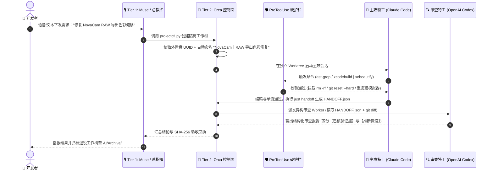
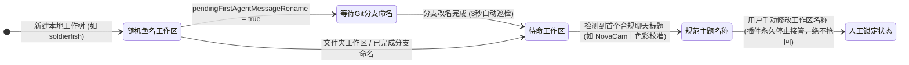

<div align="center">


<br/>

[](./README.zh-CN.md)
[](./README.en.md)
[](./AGENT_INSTALL.md)
[](https://github.com/Rem021/orca-multi-agent-blueprint)
[](./LICENSE)

**面向重度多智能体开发者的 macOS 生产级三层可插拔架构 · 180+ Git 工作树治理 · 零配置一键部署蓝图**

[⚡ 30 秒极速部署](#-一30-秒极速部署支持新设备与存量多项目设备) · [🏛️ 三层可插拔架构](#️-二三层可插拔架构设计3-tier-pluggable-stack) · [📂 目录与命名规范](#-四外置专盘目录标准与四分法体系) · [🛡️ 硬护栏与技能矩阵](#️-六全套技能矩阵与安全硬护栏) · [📈 实测工程收益](#-八核心痛点修复与量化收益对比)

</div>

---

## ⚡ 一、30 秒极速部署（支持新设备与存量多项目设备）

无论你是一台**刚拆封的全新 Mac**，还是一台**已经有几十个存量项目、几百个 Git 工作树与多个 AI Agent 的主力开发机**，都可以通过以下任意一种方式**全自动无损部署**整套体系：

> [!TIP]
> **方式 A：直接把仓库链接发给你的任意 AI Agent（零手动操作）**
> 复制下面这句话，发送给你的 **Claude Code / OpenAI Codex / Google Antigravity / Cursor / Muse**：
> ```text
> 请阅读 https://github.com/Rem021/orca-multi-agent-blueprint/blob/main/AGENT_INSTALL.md 并按步骤为我自动部署和优化本机多 Agent 工作流（先运行 --dry-run 预览，再执行 --auto 部署并输出 doctor.py 报告）。
> ```

### 方式 B：终端一行命令全自动部署（`bootstrap.sh`）

打开 macOS 终端（Terminal / Ghostty / iTerm2），复制粘贴以下一行命令：

```bash
curl -fsSL https://raw.githubusercontent.com/Rem021/orca-multi-agent-blueprint/main/bootstrap.sh | zsh
```

<details>
<summary>🔍 <b>想先预览不改文件？或查看这一行命令在底层自动完成了哪 6 件事？（点击展开）</b></summary>

<br/>

**只读预览模式（`--dry-run`，零文件修改）：**
```bash
curl -fsSL https://raw.githubusercontent.com/Rem021/orca-multi-agent-blueprint/main/bootstrap.sh | zsh -s -- --dry-run
```

**全自动引擎 (`bootstrap.sh` + `scripts/discover_and_adopt.py`) 执行的 6 个步骤：**
1. **自动探测存储卷与硬件 UUID**：自动识别 `/Volumes/*` 下的外置高速 SSD（提取硬件 `VolumeUUID` 防止未挂载误写），若无外置盘则平滑回退至 `~/AI-Workspace`。
2. **存量项目无损纳管**：自动扫描 `AI/Projects/*` 与 Orca 已登记仓库（`orca repo list`），在不改动任何业务源码的前提下补齐 `docs/`、`reports/`、`outputs/`、`work/` 四分法目录，并将 `/work/` 写入 `.git/info/exclude`。
3. **自动探测 iOS 模拟器与已装 Agent**：自动扫描 `xcrun simctl` 可用机型生成主/副测试机租约配置，探测本机已安装的 `claude`、`codex`、`antigravity`、`dsh`、`opencode`、`cursor` 并生成 `config.env`。
4. **免依赖安装原生 CLI 加速工具链**：无需 Homebrew 或 `gh` 登录，自动根据芯片架构（`arm64` / `x86_64`）将 `rg`、`fd`、`ast-grep`、`just`、`xcbeautify`、`scc`、`repomix` 装入 `~/.local/bin` 并配置 `~/.zshenv`。
5. **多账号/多 Profile 零偏差对齐**：一键将全局规则（`AGENTS.md` / `CLAUDE.md` / `GEMINI.md`）、`PreToolUse` 安全硬护栏、Xcode MCP 桥接与全部技能软链同步到 Orca 下的**所有** Claude Profiles、Codex Accounts 与 Antigravity 会话。
6. **单元测试与健康审计**：自动运行 `test_guard.py`、`orca-naming-guard` 测试集与 `doctor.py` 全景体检。

</details>

---

## 🏛️ 二、三层可插拔架构设计（3-Tier Pluggable Stack）

在重度 AI 辅助工程中，单一 Agent 往往受限于上下文窗口污染、单账号 Rate Limit 限流、多工作树文件冲突以及非交互式 Shell 环境断层。本方案将工作流解耦为**可自由替换的三层架构**：

<div align="center">
  
</div>

### 2.1 三层职责与无缝热插拔机制

| 层级 | 架构角色 | 默认配置 | 可无缝替换的备选方案 (`config.env`) | 核心职责 |
| :--- | :--- | :--- | :--- | :--- |
| **Tier 1** | **前端总指挥官**<br/>*(Supervisor)* | **Muse**<br/>*(语音/桌面意图中心)* | · **Orca Mobile** *(手机远程语音)*<br/>· **Claude Desktop / Cowork**<br/>· **OpenClaw / 自定义 Webhook** | 接收自然语言需求、拆解跨项目任务、向中枢下发工作树指令、汇总审计简报 |
| **Tier 2** | **调度中枢与控制面**<br/>*(Control Plane)* | **Orca Desktop + CLI**<br/>*(macOS 本地调度器)* | · **`just` + `projectctl.py`** *(纯 CLI)*<br/>· **GNU Parallel / 编排脚本** | 管理 180+ Git 工作树生命周期、多账号配额自动故障转移、运行零 Token 命名插件与 `PreToolUse` 硬护栏 |
| **Tier 3** | **执行特工矩阵**<br/>*(Worker Fleet)* | **Claude Code + Codex + Antigravity + DeepSeek** | · **OpenCode / Cursor / Windsurf**<br/>· **Aider / 任意本地开源模型** | 在各自独立的 Git Worktree 沙箱中并行编码、AST 重构、运行模拟器测试并互审代码 |

> [!IMPORTANT]
> **如何更换前端总指导或底层 Agent？**
> 只需修改 [`config.env`](./config.example.env) 中的 `SUPERVISOR_AGENT` 与 `WORKER_AGENTS`，然后执行 `./deploy.sh --sync-profiles`，即可在 2 秒内完成全栈切换，底层工作树结构与安全防线完全不受影响。

---

## 🔄 三、五步确定性研发闭环与跨模型互审

从前端下发一句话需求，到多模型在独立工作树中编码、交接、互审直至安全归档，全流程遵循以下 **5 步确定性流水线**：

<div align="center">
  
</div>

### Hub-and-Spoke 跨模型对抗性审查（Claude 写 ↔ Codex 审）

避免“单模型自写自夸”的幻觉盲区：主攻特工完成开发后，通过 `just handoff` 生成高密度 JSON 交接包（仅含 Git Base/Head SHA、变更文件 SHA-256 摘要与测试回执，**节省 80% 上下文 Token**），交由异构模型在只读上下文中做对抗性审查：



---

## 📂 四、外置专盘目录标准与“四分法”体系

为彻底解决多 Agent 常见的**“把大文件写进系统盘或 iCloud 同步目录”、“把临时分析脚本提交进 Git 主干”、“外置盘未挂载时在 `/Volumes/xxx` 挂载点下误建假目录”**三大顽疾，本方案采用严格的硬件级目录隔离标准（以下使用虚拟示例盘 `/Volumes/AI_Workspace` 与虚拟项目名演示）：

```text
/Volumes/AI_Workspace/               # 专用外置高速 SSD（每次写入前强制校验硬件 VolumeUUID）
└── AI/
    ├── Projects/                    # 【唯一主入口层】每个项目仅保留一个主克隆，长期停靠 main 且保持 clean
    │   ├── Mac/                     # 系统维护、多 Agent 编排工具与全局治理主仓
    │   ├── NovaCam/                 # 示例项目 A：专业相机应用主克隆
    │   ├── FlowWeave/               # 示例项目 B：跨平台规则与工作流引擎主克隆
    │   ├── StarFront/               # 示例项目 C：实时策略游戏主克隆
    │   └── <任意项目>/               # 统一实行项目内“四分法”标准结构：
    │       ├── docs/                #   1. 长期文档：架构规范、设计说明、运行手册（入 Git）
    │       ├── reports/             #   2. 审计回执：按 YYYY-MM-DD-topic 存放阶段报告与 JSON 证据（入 Git）
    │       ├── outputs/             #   3. 正式产物：可复用插件、工具脚本、交付包（入 Git）
    │       └── work/                #   4. 临时试验场：日志、草稿、第三方参考代码（写入 .git/info/exclude，严禁入 Git）
    │
    ├── Orca/Worktrees/              # 【Orca 隔离工作树池】每个并行任务独立一个目录，绝不污染主入口
    ├── Codex/Worktrees/             # 【Codex 隔离工作树池】如 NovaCam-raw-color-fix
    ├── Claude/Worktrees/            # 【Claude 隔离工作树池】
    │
    ├── Archive/                     # 【可逆冷归档区】退役工作树必先打包至此，校验通过才允许清理工作树
    │   └── 2026-11-06-raw-fix/      #   内含 repo.bundle + worktree-snapshot.tar.gz + SHA256SUMS.txt
    │
    └── Data/                        # 【共享缓存与硬件协调锁】
        ├── BuildCache/              #   Xcode SourcePackages (SPM) 跨工作树共享缓存（DerivedData 仍按工作树隔离）
        └── SimulatorCoordination/   #   iOS 模拟器租约锁 (active-*/lease.json)，防止多 Agent 抢同一台模拟器
```

> [!WARNING]
> **外置盘防脱盘死锁机制**：每次执行任务或脚本写入前，`projectctl.py`、`doctor.py` 与 `agent-guard` 都会通过 `diskutil info -plist` 校验外置盘挂载状态与硬件 `VolumeUUID`。一旦发现外置盘离线，**立即阻断操作**，绝不在 `/Volumes/` 挂载点或 `~/Documents` 下自建假目录。

---

## 🏷️ 五、工作区、聊天与 Git 分支命名铁律（零 Token 自动治理）

当同时管理 **180+ 个工作区**与数十个聊天标签时，原生的随机英文鱼名（如 `lancetfish`、`soldierfish`）或冗长的请求口吻标题会让开发者完全找不到北。

### 5.1 统一命名规范表（使用虚拟项目名演示）

| 对象类型 | 命名格式规则 | 规范示例（虚拟项目名） |
| :--- | :--- | :--- |
| **主项目入口** | `正式产品名或领域名` | `NovaCam`、`流织`、`星际前线`、`ChromaStudio`、`Mac` |
| **专项项目入口** | `项目名｜用途` | `NovaCam｜色彩引擎开发` |
| **工作树与有主题聊天** | `项目名｜具体主题` | `Mac｜Orca 多智能体设置与命名整理`、`ChromaStudio｜色轮并发渲染修复` |
| **尚无任务的空闲工作区** | `项目名｜待命工作区 <稳定短编号>` | `NovaCam｜待命工作区 888c8500` |
| **导入资料工作区** | `项目名｜导入资料`（必要时追加 A/B） | `NovaCam｜导入资料 A` |
| **失效旧路径历史登记** | `项目名｜原用途（历史登记）` | `NovaCam｜单次拍摄实验（历史登记）` |
| **新 Git 任务分支** | `<前缀>/<2-4 个英文单词 kebab-case>` | `codex/cloud-rule-save`、`claude/hdr-highlight-fix` |

**排版三项细节要求**：
1. 标题只用一个**全角竖线 `｜`**，竖线两侧**不加空格**；
2. 中文与英文/数字技术名词之间**留一个半角空格**（如 `NovaCam｜Metal4 渲染管线接管`）；
3. 标题控制在 40 字以内，省略无意义的日期前缀、Emoji、“请帮我...”请求口吻和未经证实的“已完成”字样。

### 5.2 [`plugins/orca-naming-guard`](./plugins/orca-naming-guard) 状态机生命周期

本仓库内置的 `orca-naming-guard` 是运行在 Orca 本地的 `trusted-worker` 插件，**不调用任何大模型、零 Token 消耗**：



---

## 🛡️ 六、全套技能矩阵与安全硬护栏

### 6.1 核心技能矩阵（全 Profile 自动同步）

`./deploy.sh --auto` 会将以下技能统一链接到 `~/.agents/skills`、`~/.claude/skills`、`~/.codex/skills`、`~/.gemini/config/skills` 以及 Orca 下所有的多账号/多 Profile 目录：

| 技能类别 | 技能名称 | 核心工程作用 |
| :--- | :--- | :--- |
| **Orca 官方控制类** | `orchestration` | 跨 Agent 派发子任务（支持在 Claude 中派发 Codex Worker 审查并回收结果） |
| **Orca 官方控制类** | `orca-cli` | 编程方式操控 Orca 工作树、受管终端（`terminal send/wait/read`）、评论与内置浏览器 |
| **Orca 官方控制类** | `orca-emulator` | 直接在 Orca 模拟器面板操控 iOS Simulator（点击、手势、无障碍树读取、截图） |
| **Orca 官方控制类** | `orca-computer-use` | 通过 macOS 无障碍树与截图驱动本地原生 GUI 窗口（仅在 CLI 无法触达时使用） |
| **结构化搜索与工具链** | [`ast-grep`](./skills/ast-grep/SKILL.md) | 语法树级（AST）精准搜索与重构，配合 `rg`、`fd`、`xcbeautify`、`repomix`、`just` |
| **存储治理与清理** | `agent-slim` / `mole` | 识别 AI 会话孤儿缓存、SQLite 空闲页与构建垃圾，利用 APFS `cp -c` 写时复制无损去重 |
| **Apple 专项精调** | `swiftui-specialist` / `xctrace` 等 | Apple 官方最新 SwiftUI / App Intents 规范与 `xctrace` 命令行性能剖析指南 |

### 6.2 `PreToolUse` 确定性安全硬护栏（[`scripts/guard.py`](./scripts/guard.py)）

写在 Markdown 里的规则只能“劝告”模型，而挂载在 Claude Code、Codex 与 Antigravity `PreToolUse` 钩子上的 `~/.local/bin/agent-guard` 则在**命令执行前毫秒级物理拦截**违规操作（退出码 `2` 并返回结构化阻断原因）：

| 拦截规则编号 | 严禁执行的危险命令模式 | 硬护栏拦截后的强制替代路径 |
| :--- | :--- | :--- |
| **Rule 01** | 外置工作盘未挂载时读写 `/Volumes/<Drive>/AI` | 立即阻断，防止在未挂载的空目录桩上创建假文件 |
| **Rule 02** | 对 `AI/Projects`、`Worktrees`、`Archive` 执行 `rm -rf` | 必须先执行 `just archive-worktree` 归档并移入废纸篓，再用 `git worktree remove` |
| **Rule 03** | `git reset --hard` 或 `git clean -f / -fdx` | 必须先通过 `git bundle` 与 `.tar.gz` 将未提交改动保存至 `AI/Archive/` |
| **Rule 04** | 不带 `--dry-run` 的 `git worktree prune` | 必须先运行 `git worktree prune --dry-run` 人工核验外置盘状态 |
| **Rule 05** | `xcrun simctl create` 或 `xcrun simctl clone` | 严禁无限克隆模拟器占满磁盘；必须复用指定主/副模拟器并检查租约锁 |
| **Rule 06** | 清空废纸篓（`rm -rf ~/.Trash/*` / `EmptyTrash`） | 移入废纸篓的工作树与归档副本必须保留可恢复性 |
| **Rule 07** | 推送含历史敏感配置的受限分支（`develop` / `feat/C-*`） | `PreToolUse` + Git `pre-push` 双重拦截，防止历史敏感分支泄露至远端 |

---

## 🛠️ 七、日常标准运维指令（`Justfile`）

部署完成后，你可以在工作区根目录下直接通过 `just` 执行所有日常治理操作：

```bash
just --list                                  # 查看所有标准运维指令
just verify-volume                           # 1. 核验外置工作盘挂载状态与硬件 UUID
just doctor                                  # 2. 运行全面只读健康诊断 (Schema v2，含多账号对齐核验)
just slim-status                             # 3. 盘点所有 AI Agent 物理/逻辑占用与 SQLite 空闲页
just sim-leases                              # 4. 查看当前 iOS 模拟器协调租约与活跃 xcodebuild 进程
just test-guardrails                         # 5. 运行安全硬护栏单元测试
just handoff repo="." goal="完成阶段开发"      # 6. 生成跨 Agent 交接回执包 (HANDOFF.json)
just archive-worktree <path> <topic>         # 7. 安全打包归档工作树到 AI/Archive/ (含 SHA256SUMS.txt)
```

---

## 📈 八、核心痛点修复与量化收益对比

| 工程维度 | 优化前（原生多 Agent 混用状态） | 优化后（部署本 Blueprint 方案） | 实测工程收益 |
| :--- | :--- | :--- | :--- |
| **多账号限流故障转移** | 主账号限流切换到备用 Profile 后，丢失全局规则、Xcode MCP 与大半技能 | `sync_profiles.py` 自动保持所有 Claude/Codex/Antigravity 账号 100% 同构 | **切换账号零心智负担、能力零降级** |
| **非交互式 Shell 工具链** | AI 子进程找不到 `rg`/`fd`/`ast-grep`，退化为慢速 `grep -R` 扫描整个 `work/` | `~/.zshenv` 注入 `~/.local/bin` 原生 `arm64` 工具链 + `.git/info/exclude` 忽略 `/work/` | **代码检索提速 5~10 倍，杜绝无用目录刷爆 Token** |
| **Xcode 编译测试输出** | `xcodebuild` 原始数万行日志直接塞满上下文窗口，挤掉核心代码记忆 | 统一经 `xcbeautify` 过滤 + 单模拟器并发标志 + `SimulatorCoordination` 租约锁 | **编译日志 Token 消耗降低 ~90%，模拟器零死锁** |
| **破坏性命令防御** | 仅靠 Prompt 提醒，Agent 偶尔仍会跑出 `git reset --hard` 或误删未合并目录 | `PreToolUse` 钩子 + `agent-guard` 在命令执行前毫秒级硬拦截 | **100% 物理阻断高危删改命令** |
| **180+ 工作树与会话命名** | 满屏随机英文鱼名（`soldierfish`），靠人工肉眼分辨或消耗模型额度改名 | `orca-naming-guard` 本地状态机自动生成待命编号并同步首个合规中文标题 | **零 Token 消耗，3 秒内自动规整工作区命名** |
| **跨 Agent 任务交接** | 复制粘贴大段聊天记录，下家 Agent 仍不清楚改了哪些文件、哪些已验证 | `just handoff` 一键导出 Git Base/Head、变更文件 SHA-256 与验收证据清单 | **交接上下文体积缩减 80%，证据链 100% 可复核** |

---

## 📦 九、仓库目录结构速览

```text
orca-multi-agent-blueprint/
├── assets/                          # 现代深色视觉矢量图表 (Hero Banner / 三层架构图 / 生命周期图)
├── bootstrap.sh                     # 一行命令全自动引导脚本 (支持 curl | zsh 零配置部署)
├── deploy.sh                        # 核心部署引擎 (--auto / --apply / --dry-run / --sync-profiles / --doctor)
├── AGENT_INSTALL.md                 # 专供 AI Agent 阅读执行的自动化安装协议
├── config.example.env               # 参数化配置模板 (工作盘路径、总指挥 Agent、执行特工池、模拟器 UDID)
├── Justfile                         # 7 个日常标准运维配方 (just doctor / handoff / archive-worktree 等)
├── scripts/
│   ├── discover_and_adopt.py        # 智能环境探测与存量多项目无损纳管引擎
│   ├── install_cli_tools.sh         # 免 Homebrew/gh 登录的 GitHub Releases 原生二进制安装器
│   ├── sync_profiles.py             # 多 Agent / 多账号技能、MCP、规则与 Hook 同步脚本
│   ├── guard.py                     # PreToolUse & Git pre-push 确定性安全硬护栏
│   ├── doctor.py                    # Schema v2 全景只读健康审计工具
│   ├── handoff.py                   # 跨 Agent 高密度交接包生成器 (HANDOFF.json)
│   ├── projectctl.py                # 受保护的工作树创建与外置盘 UUID 核验工具
│   └── agent-slim.py                # AI Agent 存储全景盘点与无损瘦身工具
├── plugins/
│   └── orca-naming-guard/           # 零 Token 消耗的 Orca 工作区中文命名守护插件 (含完整单测)
├── skills/
│   └── ast-grep/SKILL.md            # 结构化 AST 搜索与原生 CLI 工具链技能定义
├── templates/
│   └── AGENTS.md.tmpl               # 可参数化渲染的全局规则模板 (AGENTS.md / CLAUDE.md / GEMINI.md)
└── tests/
    └── test_guard.py                # 安全硬护栏完整单元测试套件
```

## 📄 开源协议

本项目基于 [MIT License](./LICENSE) 开源。欢迎 Fork 并根据你自己的 Agent 组合定制专属工作流！
