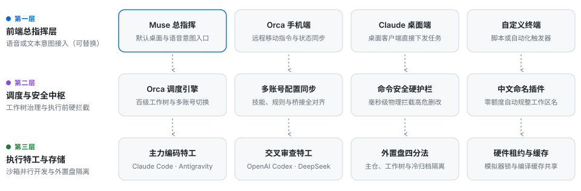

# Orca 多智能体协同与工作树治理蓝图

[](./README.md)
[](./AGENT_INSTALL.md)
[-1a7f37?style=flat)](https://github.com/Rem021/orca-multi-agent-blueprint)
[](https://github.com/Rem021/orca-multi-agent-blueprint)
[](./scripts/guard.py)
[](./LICENSE)

> **语言切换**：[**👉 Click here for the English Version (`README.md`)**](./README.md)

面向 macOS 重度多智能体开发者的生产级三层可插拔架构、多工作树隔离标准与一键自动部署方案。支持在**全新 Mac** 或**已有大量存量项目与多个 AI 智能体的主力开发机**上无损落地。

---

## 一、快速部署（支持全新设备与存量多项目设备）

### 方式 A：直接将本仓库链接发送给任意 AI 智能体（零手动操作）

复制以下文本，发送给你的 **Claude Code、OpenAI Codex、Google Antigravity、Cursor 或 Muse**：

```text
请阅读 https://github.com/Rem021/orca-multi-agent-blueprint/blob/main/AGENT_INSTALL.md 并按步骤自动部署和优化本机多智能体工作流（先运行 --dry-run 预览，再执行 --auto 部署并输出 doctor.py 诊断报告）。
```

### 方式 B：终端一行命令自动部署

在终端（Terminal / Ghostty / iTerm2）中执行：

```bash
curl -fsSL https://raw.githubusercontent.com/Rem021/orca-multi-agent-blueprint/main/bootstrap.sh | zsh
```

如需先以只读模式预览将要执行的动作（不修改任何文件）：

```bash
curl -fsSL https://raw.githubusercontent.com/Rem021/orca-multi-agent-blueprint/main/bootstrap.sh | zsh -s -- --dry-run
```

**自动化部署脚本完成的 6 项核心工作：**
1. **自动识别存储卷与硬件编号**：自动扫描 `/Volumes/*` 下的外置高速固态硬盘并记录硬件 `VolumeUUID`（防止外置盘未挂载时误写系统盘）；若无外置盘则自动回退至 `~/AI-Workspace`。
2. **存量项目无损纳管**：自动扫描 `AI/Projects/*` 与 Orca 已登记仓库，在不修改任何业务源码的前提下补齐 `docs/`、`reports/`、`outputs/`、`work/` 四个标准目录，并将 `/work/` 写入 `.git/info/exclude`。
3. **自动探测模拟器与已安装智能体**：自动扫描本机可用的 iOS 模拟器与已安装的命令行智能体，生成参数化配置文件 `config.env`。
4. **免依赖安装原生加速工具链**：无需预先配置包管理器，自动识别芯片架构并将 `rg`、`fd`、`ast-grep`、`just`、`xcbeautify`、`scc`、`repomix` 装入 `~/.local/bin`，同时写入 `~/.zshenv` 确保非交互式子进程始终可用。
5. **多账号与多环境配置同步**：将全局规则文件、命令安全硬护栏、Xcode 桥接服务与全部技能软链接同步到 Orca 下的所有账号与配置目录。
6. **自动自检与健康审计**：运行安全硬护栏单元测试、命名插件测试与只读全景健康检查。

---

## 二、三层可插拔架构设计

为解决单一智能体常见的**上下文窗口污染、单账号限流中断、多任务代码互相覆盖、后台子进程找不到工具链**四大痛点，本方案将整套系统解耦为可随时替换的三层结构：

<p align="center">
  <picture>
    <source media="(prefers-color-scheme: dark)" srcset="./assets/architecture-zh-dark.svg">
    <source media="(prefers-color-scheme: light)" srcset="./assets/architecture-zh-light.svg">
    
  </picture>
</p>

| 层级 | 架构角色 | 默认配置 | 可直接替换的备选方案（修改 `config.env`） | 核心职责 |
| :--- | :--- | :--- | :--- | :--- |
| **第一层** | **前端总指挥** | **Muse** | Orca 手机端、Claude 桌面端、自定义脚本 | 接收自然语言需求、拆解跨项目任务、向中枢下发工作树指令、汇总验收结果 |
| **第二层** | **调度与护栏中枢** | **Orca 桌面端与 CLI** | `just` + `projectctl.py` 纯命令行调度 | 管理上百个工作树生命周期、多账号配额自动切换、运行命令安全硬护栏与中文命名守护插件 |
| **第三层** | **执行与审查特工池** | **Claude + Codex + Antigravity + DeepSeek** | OpenCode、Cursor、Windsurf、Aider | 在各自独立的 Git 工作树沙箱中并行编码、语法树重构、运行模拟器测试并交叉互审 |

> [!NOTE]
> 如需更换前端总指挥或底层执行智能体，只需修改 [`config.env`](./config.example.env) 中的 `SUPERVISOR_AGENT` 与 `WORKER_AGENTS`，随后运行 `./deploy.sh --sync-profiles` 即可完成切换。

---

## 三、五步确定性研发与归档流程

从下发任务到最终合入主干并归档工作树，全流程遵循五步标准闭环：

<p align="center">
  <picture>
    <source media="(prefers-color-scheme: dark)" srcset="./assets/workflow-zh-dark.svg">
    <source media="(prefers-color-scheme: light)" srcset="./assets/workflow-zh-light.svg">
    
  </picture>
</p>

1. **创建隔离工作树**：通过 `projectctl.py` 核验外置盘在线状态，从干净的 `main` 主仓拉取独立工作树与任务分支。
2. **护栏下并行开发**：主攻智能体在独立工作树内编码，所有终端命令均经 `agent-guard` 事前校验，Xcode 编译输出经 `xcbeautify` 压缩降噪。
3. **生成紧凑交接包**：执行 `just handoff` 自动提取分支基准哈希、变更文件 `SHA-256` 摘要与验证回执，无需复制冗长聊天记录即可缩减约 80% 交接上下文。
4. **异构模型互审**：由另一模型（如 Claude 编码后交由 Codex 审查）读取交接包与代码差异进行只读审计，严格区分“已核验证据”与“推断假设”。
5. **安全打包归档**：任务合入后，通过 `just archive-worktree` 生成完整 Git 镜像包（`repo.bundle`）、目录快照（`.tar.gz`）与 `SHA256SUMS.txt` 校验单存入 `AI/Archive/`，再清理工作树。

---

## 四、外置盘目录规范与“四分法”体系

以下采用虚拟工作盘路径 `/Volumes/AI_Workspace` 与虚拟项目名称（`NovaCam`、`流织`、`星际前线`、`ChromaStudio`）展示标准目录结构：

```text
/Volumes/AI_Workspace/               # 专用工作盘（每次写入前自动核验挂载状态与硬件 UUID）
└── AI/
    ├── Projects/                    # 【唯一主入口层】每个项目仅保留一个主克隆，长期停靠 main 分支且保持干净
    │   ├── Mac/                     # 系统维护、多智能体编排工具与全局治理主仓
    │   ├── NovaCam/                 # 虚拟示例项目 A：专业相机应用主仓
    │   ├── FlowWeave/               # 虚拟示例项目 B：跨平台工作流引擎主仓
    │   ├── StarFront/               # 虚拟示例项目 C：实时策略游戏主仓
    │   └── <任意项目>/               # 统一实行项目内“四分法”标准结构：
    │       ├── docs/                #   1. 长期文档：架构规范、设计说明、运行手册（纳入版本控制）
    │       ├── reports/             #   2. 审计回执：按“日期-主题”存放阶段报告与验收证据（纳入版本控制）
    │       ├── outputs/             #   3. 正式产物：可复用插件、工具脚本、发布包（纳入版本控制）
    │       └── work/                #   4. 临时试验场：日志、草稿、参考代码（写入 .git/info/exclude，严禁入库）
    │
    ├── Orca/Worktrees/              # 【Orca 隔离工作树池】每个并行任务独立一个目录，绝不污染主入口
    ├── Codex/Worktrees/             # 【Codex 隔离工作树池】例如 NovaCam-raw-color-fix
    ├── Claude/Worktrees/            # 【Claude 隔离工作树池】
    │
    ├── Archive/                     # 【可逆冷归档区】退役工作树必先打包至此，校验通过后才允许移出工作树
    │   └── 2026-11-06-raw-fix/      #   内含 repo.bundle + worktree-snapshot.tar.gz + SHA256SUMS.txt
    │
    └── Data/                        # 【共享缓存与硬件协调锁】
        ├── BuildCache/              #   跨工作树共享编译包缓存（各工作树构建产物仍保持隔离）
        └── SimulatorCoordination/   #   iOS 模拟器租约锁目录，防止多智能体并发抢占同一台模拟器
```

---

## 五、工作区、聊天与分支命名规范

在同时管理上百个工作区与数十个会话标签时，统一命名规范配合本地 [`plugins/orca-naming-guard`](./plugins/orca-naming-guard) 插件可实现**零模型额度消耗的自动规整**：

| 对象类型 | 命名格式规则 | 规范示例（虚拟项目名称） |
| :--- | :--- | :--- |
| **主项目入口** | `正式产品名或领域名` | `NovaCam`、`流织`、`星际前线`、`ChromaStudio`、`Mac` |
| **专项项目入口** | `项目名｜用途` | `NovaCam｜色彩引擎开发` |
| **工作树与有主题聊天** | `项目名｜具体主题` | `Mac｜多智能体设置与命名整理`、`ChromaStudio｜色轮并发渲染修复` |
| **尚无任务的空闲工作区** | `项目名｜待命工作区 <稳定短编号>` | `NovaCam｜待命工作区 888c8500` |
| **导入资料工作区** | `项目名｜导入资料`（必要时追加编号） | `NovaCam｜导入资料 A` |
| **失效旧路径历史登记** | `项目名｜原用途（历史登记）` | `NovaCam｜单次拍摄实验（历史登记）` |
| **新 Git 任务分支** | `<前缀>/<2至4个英文单词连字符分隔>` | `codex/cloud-rule-save`、`claude/hdr-highlight-fix` |

**三项排版细节：**
1. 标题固定使用一个**全角竖线 `｜`**，竖线两侧**不加空格**；
2. 中文与英文或数字名词之间**留一个半角空格**（例如 `NovaCam｜Metal4 渲染管线重构`）；
3. 标题控制在 40 字以内，不加日期前缀、表情符号、请求口吻或未经核实的“已完成”字样。

---

## 六、全套技能矩阵与命令安全硬护栏

### 6.1 核心技能列表（全账号自动对齐）

| 技能类别 | 技能名称 | 核心工程用途 |
| :--- | :--- | :--- |
| **中枢编排与控制** | `orchestration` | 跨智能体派发子任务（例如在主会话中派发独立审查工作树并回收结论） |
| **中枢编排与控制** | `orca-cli` | 以命令行方式管理工作树、受管终端读写等待、仓库配置与内置浏览器 |
| **模拟器与界面交互** | `orca-emulator` | 控制已启动的 iOS 模拟器（点击、手势滑动、读取无障碍节点树与截图） |
| **模拟器与界面交互** | `orca-computer-use` | 当命令行无法完成任务时，通过无障碍树驱动本地桌面窗口完成界面校验 |
| **语法树检索与工具链** | [`ast-grep`](./skills/ast-grep/SKILL.md) | 语法树级精准搜索与批量重构，配合 `rg`、`fd`、`xcbeautify`、`repomix`、`just` |
| **存储瘦身与治理** | `agent-slim` / `mole` | 盘点智能体缓存、清理数据库空闲页，利用文件系统写时复制机制无损去重 |

### 6.2 命令执行前硬护栏（[`scripts/guard.py`](./scripts/guard.py)）

安装在 `~/.local/bin/agent-guard` 的硬护栏挂载于所有智能体的命令执行前钩子（`PreToolUse`），在危险命令运行前直接物理阻断：

| 规则编号 | 严禁执行的危险操作 | 硬护栏强制要求的安全替代路径 |
| :--- | :--- | :--- |
| **规则 01** | 外置工作盘未挂载时读写 `/Volumes/<盘名>/AI` | 立即中止命令，严禁在未挂载的空目录桩上创建假目录 |
| **规则 02** | 对项目、工作树或归档目录直接执行 `rm -rf` | 先执行 `just archive-worktree` 归档并移入同卷废纸篓，再执行工作树移除指令 |
| **规则 03** | 执行 `git reset --hard` 或 `git clean -fdx` | 先通过 `git bundle` 与压缩快照将未提交修改备份至 `AI/Archive/` |
| **规则 04** | 执行不带 `--dry-run` 的 `git worktree prune` | 必须先加 `--dry-run` 预览，确认外置盘在线后再处理失效工作树记录 |
| **规则 05** | 执行 `xcrun simctl create` 或 `simctl clone` | 严禁无限新建或克隆模拟器占满磁盘；必须复用指定主/副模拟器并检查租约锁 |
| **规则 06** | 清空系统或外置盘废纸篓 | 移入废纸篓的工作树与归档副本必须保留可恢复性 |
| **规则 07** | 推送受保护的历史敏感分支（`develop` / `feat/C-*`） | 命令钩子与 Git `pre-push` 双重拦截，防止含历史敏感配置的分支推送到远端 |

---

## 七、日常标准运维指令（`Justfile`）

```bash
just --list                                  # 查看所有可用标准运维指令
just verify-volume                           # 1. 核验外置工作盘挂载状态与硬件 UUID
just doctor                                  # 2. 运行全景只读健康诊断与多账号对齐检查
just slim-status                             # 3. 盘点所有智能体存储占用与数据库可回收空间
just sim-leases                              # 4. 查看当前 iOS 模拟器协调租约与运行中的测试进程
just test-guardrails                         # 5. 运行命令安全硬护栏单元测试
just handoff repo="." goal="阶段开发完成"      # 6. 生成高密度跨智能体交接回执包 (HANDOFF.json)
just archive-worktree <路径> <主题>           # 7. 安全打包归档工作树至 AI/Archive/ (含 SHA-256 校验单)
```

---

## 八、核心痛点修复与收益对比

| 工程维度 | 优化前（原生分散使用状态） | 优化后（部署本套蓝图） | 实际工程收益 |
| :--- | :--- | :--- | :--- |
| **多账号限流切换** | 主账号限流切换到备用账号后，丢失全局规则、编译桥接与技能 | `sync_profiles.py` 自动保持所有账号配置 100% 一致 | **账号切换零断层、能力零降级** |
| **后台进程工具链** | 非交互式子进程找不到加速工具，退化为慢速全盘扫描 `work/` 目录 | `~/.zshenv` 注入原生工具链，`.git/info/exclude` 自动忽略 `/work/` | **代码检索提速 5~10 倍，杜绝临时文件刷爆上下文** |
| **编译与测试日志** | 数万行原始编译输出直接塞满上下文窗口，挤占核心代码记忆 | 统一经 `xcbeautify` 过滤降噪，配合单并发标志与模拟器租约锁 | **编译日志上下文占用减少约 90%，模拟器零死锁** |
| **高危命令防御** | 仅靠提示词叮嘱，智能体偶发执行 `git reset --hard` 或误删目录 | `agent-guard` 在命令执行前毫秒级物理拦截 | **100% 阻断未归档删改操作** |
| **海量工作区命名** | 满屏随机英文鱼名，靠人工肉眼分辨或额外消耗模型额度改名 | 本地命名守护插件自动分配待命编号并同步首个合规中文标题 | **零模型额度消耗，3 秒内自动规整工作区名称** |
| **跨智能体任务交接** | 粘贴大段聊天记录，接手智能体仍不清楚具体改动文件与验证状态 | `just handoff` 一键导出分支哈希、变更文件校验值与证据清单 | **交接上下文缩减约 80%，改动范围一目了然** |

---

## 九、仓库目录结构

```text
orca-multi-agent-blueprint/
├── assets/                          # 自动适配深浅色模式的单层圆角矢量图（中英分版）
├── bootstrap.sh                     # 一行命令全自动引导脚本
├── deploy.sh                        # 核心部署引擎 (--auto / --apply / --dry-run / --sync-profiles / --doctor)
├── AGENT_INSTALL.md                 # 供 AI 智能体自动阅读执行的安装协议
├── config.example.env               # 参数化配置模板
├── Justfile                         # 7 个日常标准运维指令配方
├── scripts/
│   ├── discover_and_adopt.py        # 智能环境探测与存量项目无损纳管脚本
│   ├── install_cli_tools.sh         # 原生命令行加速工具链自动安装脚本
│   ├── sync_profiles.py             # 多智能体与多账号技能、规则、钩子同步脚本
│   ├── guard.py                     # 命令执行前安全硬护栏脚本
│   ├── doctor.py                    # 全景只读健康审计工具
│   ├── handoff.py                   # 跨智能体紧凑交接包生成工具
│   ├── projectctl.py                # 受保护的工作树创建与外置盘核验工具
│   └── agent-slim.py                # 智能体存储占用盘点与无损瘦身工具
├── plugins/
│   └── orca-naming-guard/           # 零额度消耗的工作区中文命名守护插件（含完整测试）
├── skills/
│   └── ast-grep/SKILL.md            # 结构化语法树检索与原生工具链技能说明
├── templates/
│   ├── AGENTS.md.tmpl               # 全局规则参数化模板
│   └── MUSE_SUPERVISOR_PLAYBOOK.md  # 前端总指挥调度手册
└── tests/
    └── test_guard.py                # 安全硬护栏单元测试套件
```
